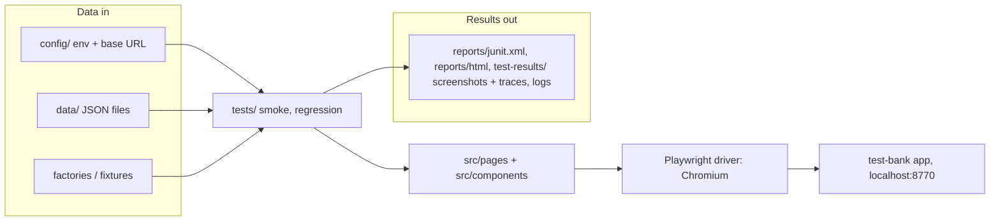

# Architecture

Pattern: **Modular** (Page Object Model + Playwright fixtures).

## Principles
- **Page Object Model:** each page is a class holding its locators and actions; tests never contain raw selectors.
- **Explicit waits:** wait for a visible element or a state, never a fixed sleep.
- **Test independence:** each test starts from its own fresh browser context, so no test depends on another.
- **Separation of concerns:** tests say what, page objects say how, config and data say with what.
